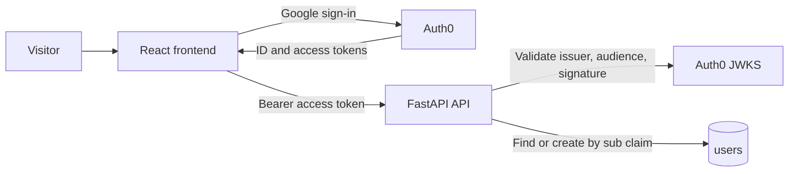
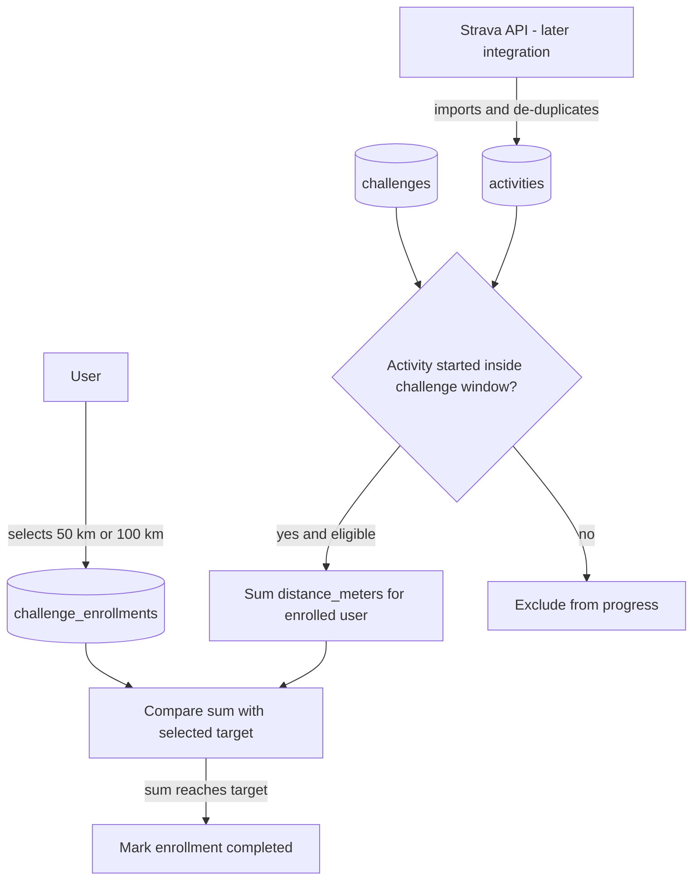

# Database Design

The database stores application data, while Auth0 remains responsible for sign-in,
Google OAuth, password security, and identity verification. Run Tib never
stores a user password.

## Entity relationship diagram

```mermaid
erDiagram
    USERS ||--o{ CHALLENGE_ENROLLMENTS : joins
    CHALLENGES ||--o{ CHALLENGE_ENROLLMENTS : contains
    USERS ||--o{ ACTIVITIES : records
    USERS ||--o| STRAVA_CONNECTIONS : connects

    USERS {
        uuid id PK
        string auth0_subject UK "Auth0 sub claim"
        string email
        string display_name
        string avatar_url
        boolean is_active
        timestamptz created_at
        timestamptz updated_at
    }

    CHALLENGES {
        uuid id PK
        string name
        text description
        timestamptz starts_at
        timestamptz ends_at
        enum status "draft, published, cancelled"
    }

    CHALLENGE_ENROLLMENTS {
        uuid id PK
        uuid user_id FK
        uuid challenge_id FK
        integer target_distance_meters "50000 or 100000"
        enum status "active, completed, withdrawn"
        timestamptz completed_at
    }

    ACTIVITIES {
        uuid id PK
        uuid user_id FK
        enum source "strava or manual"
        string external_activity_id
        string activity_type
        timestamptz started_at
        bigint distance_meters
        integer moving_time_seconds
        boolean is_eligible
        jsonb source_payload
    }

    STRAVA_CONNECTIONS {
        uuid id PK
        uuid user_id FK_UK
        bigint athlete_id UK
        string scopes
        bytes access_token_ciphertext
        bytes refresh_token_ciphertext
        timestamptz token_expires_at
        timestamptz last_synced_at
    }
```

## Authentication flow



The `auth0_subject` value comes from the validated token's `sub` claim and is the
stable identity key. Email is profile data and is not used as the primary identity,
because it can change. The frontend handles the Auth0 redirect; the backend validates
access tokens and provisions the local user through `/api/v1/auth/me`. See
[authentication setup](authentication.md) for configuration.

## Challenge progress flow



Conceptually, current progress is calculated as:

```sql
SELECT COALESCE(SUM(a.distance_meters), 0)
FROM activities AS a
JOIN challenge_enrollments AS e ON e.user_id = a.user_id
JOIN challenges AS c ON c.id = e.challenge_id
WHERE e.id = :enrollment_id
  AND a.is_eligible = true
  AND a.started_at >= c.starts_at
  AND a.started_at <= c.ends_at;
```

Activities are stored independently of a challenge. This allows one imported run to
count toward every challenge for which it is eligible, including overlapping
challenges, without importing it more than once.

## Data rules

- A user can enroll in a challenge only once.
- An enrollment target must be exactly 50,000 or 100,000 meters.
- A challenge must end after it starts.
- An activity must have a positive distance and non-negative moving time.
- A source activity ID can be imported only once, preventing Strava sync duplicates.
- Each user can connect at most one Strava athlete account.
- OAuth token columns are named `ciphertext` so plaintext tokens are never persisted.
  Encryption and key management will be implemented with the Strava integration.

## Migrations

Create a PostgreSQL database named `run_tib` (for example, in DBeaver) and set
`DATABASE_URL` in `backend/.env` to point to it.

From the `backend` directory, apply the schema:

```bash
alembic upgrade head
```

Create future migrations with:

```bash
alembic revision --autogenerate -m "describe the schema change"
```
